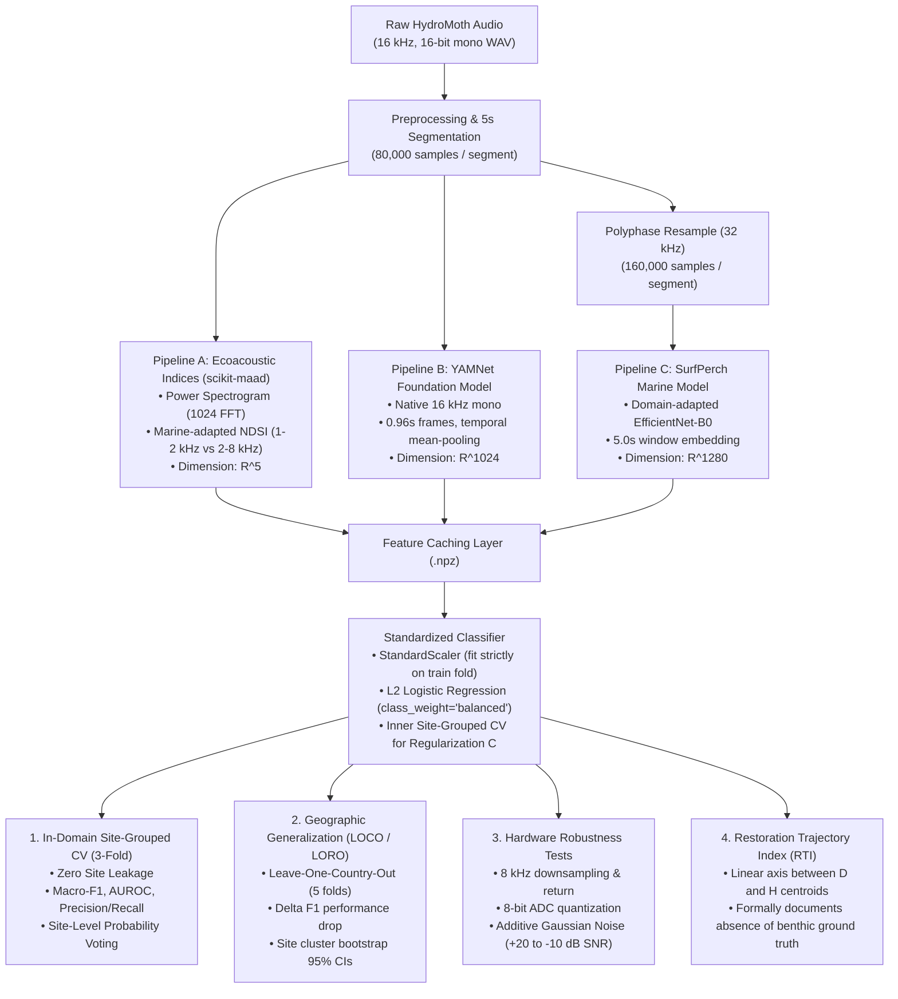

# Model Architecture & Pipeline Overview

**Document:** `MODEL_OVERVIEW.md`  
**Project:** Site-Invariant Reef Soundscape Embeddings for Zero-Shot Restoration Monitoring  
**Dataset Reference:** Williams & Jones (2025), DOI: `10.5522/04/29958062.v2`  
**Date:** 2026-10-25  

---

## 1. Quick Summary: What the System Does

This pipeline evaluates and compares **three distinct audio representations** to classify coral reef acoustic health (`Healthy`, `Degraded`, `Restoration`) from underwater passive acoustic recordings (HydroMoth / AudioMoth, 16 kHz, 16-bit PCM).

It determines:
1. Which acoustic representation best separates reef health states without site leakage.
2. How well representations generalize to **unseen geographic regions** (Australia, Indonesia, Kenya, Maldives, Mexico).
3. How robust each representation is to **degraded, low-cost recording hardware** (reduced sample rate, 8-bit quantization, environmental noise).



---

## 2. The Three Acoustic Representations

| Feature | Pipeline A: Ecoacoustic Indices | Pipeline B: YAMNet | Pipeline C: SurfPerch |
|---|---|---|---|
| **Model Type** | Handcrafted spectral statistics | General-purpose audio foundation model | Domain-adapted marine bioacoustic model |
| **Source / Library** | `scikit-maad` (pure Python) | TensorFlow Hub (`google/yamnet/1`) | Kaggle Models (`google/surfperch`) |
| **Backbone Architecture** | STFT Power Spectral Density | MobileNet-v1 (AudioSet, 521 classes) | EfficientNet-B0 (trained on reef sonotypes) |
| **Input Sample Rate** | **16,000 Hz** (native) | **16,000 Hz** (native) | **32,000 Hz** (polyphase resampled) |
| **Input Window Length** | 5.0 seconds (80,000 samples) | 5.0 seconds (80,000 samples) | 5.0 seconds (160,000 samples) |
| **Temporal Pooling** | Spectral integration across bins | Mean pooling across internal 0.96s frames | Native 5.0s window embedding |
| **Output Vector Dimension** | **$\mathbb{R}^5$** | **$\mathbb{R}^{1024}$** | **$\mathbb{R}^{1280}$** |
| **Values / Features** | `[ACI, NDSI, ADI, BI, AEI]` | Continuous 1024-d latent embedding | Continuous 1280-d latent embedding |

### Detailed Breakdown of Pipeline A Features:
1. **ACI (Acoustic Complexity Index):** Measures intensity variability across frequency bins without being skewed by constant ambient noise.
2. **NDSI (Normalized Difference Soundscape Index):** Ratio of biological energy to anthropogenic energy:
   $$\text{NDSI} = \frac{\text{Biophony} - \text{Anthrophony}}{\text{Biophony} + \text{Anthrophony}} \in [-1.0, +1.0]$$
   - *Marine Band Adaptation:* Anthrophony proxy = 1,000–2,000 Hz (hydrodynamic boat noise); Biophony proxy = 2,000–8,000 Hz (snapping shrimp clicks, biological choruses; bounded by 8 kHz Nyquist).
3. **ADI (Acoustic Diversity Index):** Shannon diversity index computed across 1 kHz frequency bins.
4. **BI (Bioacoustic Index):** Area under the sound curve across the 2,000–8,000 Hz biological band.
5. **AEI (Acoustic Evenness Index):** Gini coefficient measuring evenness of sound distribution across frequency channels.

---

## 3. The Classifier Pipeline

All three representations feed into an **identical, standardized linear probe** to guarantee a fair comparison:

- **Model Family:** $L_2$-regularized Logistic Regression (`sklearn.linear_model.LogisticRegression`).
- **Data Leakage Prevention:** `StandardScaler` is fit **strictly on the training split** and applied frozen to test data.
- **Hyperparameter Search:** Regularization parameter $C \in [10^{-4}, 10^{-3}, 10^{-2}, 10^{-1}, 1, 10, 100]$ tuned using inner site-grouped CV inside the training folds.
- **Class Imbalance Handling:** `class_weight='balanced'` ensures smaller restoration classes (`N` and `R`) receive equal weight.
- **Label Modes Supported:**
  - **4-Class Native:** `D` (Degraded), `H` (Healthy), `N` (Early-stage restored <3 mo), `R` (Mid-stage restored 32–53 mo).
  - **3-Class Configurable:** `Degraded`, `Healthy`, `Restoration` (merging N + R).

---

## 4. Evaluation & Generalization Protocols

### 4.1 In-Domain Site-Grouped Cross-Validation (RQ-1)
- Uses `StratifiedGroupKFold(n_splits=3)` grouped by `site_id`.
- **Zero Site Leakage:** All 12 segments from any physical recording site remain in the same fold.
- **Site-Level Aggregated Voting:** Averages segment predicted probabilities per site:
  $$\bar{p}_{\text{site}} = \frac{1}{N} \sum_{i=1}^N \hat{p}_i, \quad \hat{y}_{\text{site}} = \arg\max \bar{p}_{\text{site}}$$
- Resolves ties using training prior frequencies.
- Computes **95% Confidence Intervals** via **site cluster bootstrap** (1,000 resamples over site clusters).

### 4.2 Leave-One-Country-Out (LOCO / LORO) Generalization (RQ-3)
- Evaluates geographic transfer across 5 countries:
  1. Hold out **Australia** (Test classes present: D, H, R; N genuinely absent)
  2. Hold out **Indonesia** (Test classes present: D, H, N, R)
  3. Hold out **Kenya** (Test classes present: D, H, N; R genuinely absent)
  4. Hold out **Maldives** (Test classes present: D, H, N; R genuinely absent)
  5. Hold out **Mexico** (Test classes present: D, H, N, R)
- Trains probe on 4 countries, evaluates on the held-out country, and reports the performance drop ($\Delta\text{F1}$).

### 4.3 Hardware Degradation & Robustness
Applies simulated physical degradations to test audio while keeping the probe trained on clean audio:
1. **Bandwidth Reduction:** 16 kHz $\rightarrow$ 8 kHz downsampling $\rightarrow$ upsampled back to model rate (simulates low-cost hydrophone cutoffs).
2. **Bit-Depth Reduction:** 16-bit PCM uniform quantization to 8-bit precision (256 discrete bins).
3. **Additive Noise:** Gaussian noise at SNR levels of $+20\text{ dB}$, $+10\text{ dB}$, $0\text{ dB}$, and $-10\text{ dB}$.

### 4.4 Restoration Trajectory Index (RTI) & Ecological Compliance
- Computes trajectory projection:
  $$\text{RTI}(x) = \frac{(x - c_D) \cdot (c_H - c_D)}{\|c_H - c_D\|^2}$$
  where $c_D$ is the Degraded centroid and $c_H$ is the Healthy centroid (fit strictly on training data).
- **Strict Compliance:** The public Figshare dataset contains categorical labels (`D`, `H`, `N`, `R`) but **no continuous benthic measurements** (coral cover %, fish biomass). The code logs this finding and formally skips empirical correlation rather than substituting fabricated proxies.

---

## 5. Current Implementation & Execution Status

| Module / Asset | File Path | Status | Verification Check |
|---|---|:---:|---|
| **Pipeline Config** | [config.yaml](file:///c:/Users/Administrator/coral-reef/config.yaml) | Verified | Unified parameters, seeds, paths |
| **Preprocessing** | [src/ecosound/preprocessing.py](file:///c:/Users/Administrator/coral-reef/EcoSound-Audit/src/ecosound/preprocessing.py) | Verified | 5s slicing, polyphase 32 kHz resampling |
| **Features** | [src/ecosound/features.py](file:///c:/Users/Administrator/coral-reef/EcoSound-Audit/src/ecosound/features.py) | Verified | `scikit-maad` $(5,)$, YAMNet $(1024,)$, SurfPerch $(1280,)$ |
| **Training** | [src/ecosound/training.py](file:///c:/Users/Administrator/coral-reef/EcoSound-Audit/src/ecosound/training.py) | Verified | StandardScaler on train only, inner CV for C |
| **Evaluation** | [src/ecosound/evaluation.py](file:///c:/Users/Administrator/coral-reef/EcoSound-Audit/src/ecosound/evaluation.py) | Verified | Site-grouped CV (3-fold), site voting, cluster bootstrap |
| **LOCO Generalization** | [src/ecosound/generalization.py](file:///c:/Users/Administrator/coral-reef/EcoSound-Audit/src/ecosound/generalization.py) | Verified | 5-country held-out transfer folds |
| **Robustness** | [src/ecosound/robustness.py](file:///c:/Users/Administrator/coral-reef/EcoSound-Audit/src/ecosound/robustness.py) | Verified | 8 kHz, 8-bit, additive SNR noise |
| **RTI Module** | [src/ecosound/rti.py](file:///c:/Users/Administrator/coral-reef/EcoSound-Audit/src/ecosound/rti.py) | Verified | D-H projection; formal skip of unmeasured benthic stats |
| **Master Segment Manifest** | [segment_manifest.csv](file:///c:/Users/Administrator/coral-reef/EcoSound-Audit/data/sampling/segment_manifest.csv) | Verified | 1,440 segments across 12 sites generated |
| **Unit Test Suite** | [tests/test_pipeline_unit.py](file:///c:/Users/Administrator/coral-reef/tests/test_pipeline_unit.py) | **7/7 PASSED** | Executed in 14.18s |
| **Colab Smoke Test** | [EcoSound_Phase3_Colab_SmokeTest.ipynb](file:///c:/Users/Administrator/coral-reef/EcoSound-Audit/notebooks/EcoSound_Phase3_Colab_SmokeTest.ipynb) | Ready | For GPU verification of YAMNet & SurfPerch checkpoints |

---

## 6. How to Run & Verify

```powershell
# 1. Run full unit test suite
pytest tests/test_pipeline_unit.py -v

# 2. Run master segment manifest generator
python main.py --mode manifest --classes 4class

# 3. Inspect generated segment manifest
python -c "import pandas as pd; df = pd.read_csv('EcoSound-Audit/data/sampling/segment_manifest.csv'); print(df.info()); print(df['habitat_label'].value_counts())"
```
